# ParCut

**Divide y publica videos en clips, sin complicaciones.**

ParCut es una aplicación de escritorio para Windows 10 y 11 (64 bits) que importa o descarga
videos autorizados, los divide automáticamente en partes de la duración que elijas y las publica
de forma **secuencial** en YouTube, Facebook y TikTok, una parte a la vez y con confirmación real
de cada plataforma.

Incluye un **navegador integrado** con sesiones persistentes por plataforma y **Protección web de
ParCut** (bloqueo de anuncios y rastreadores), además de una **publicación asistida** que usa esas
sesiones sin pedir credenciales de desarrollador.

Desarrollado por **andrespar2**.

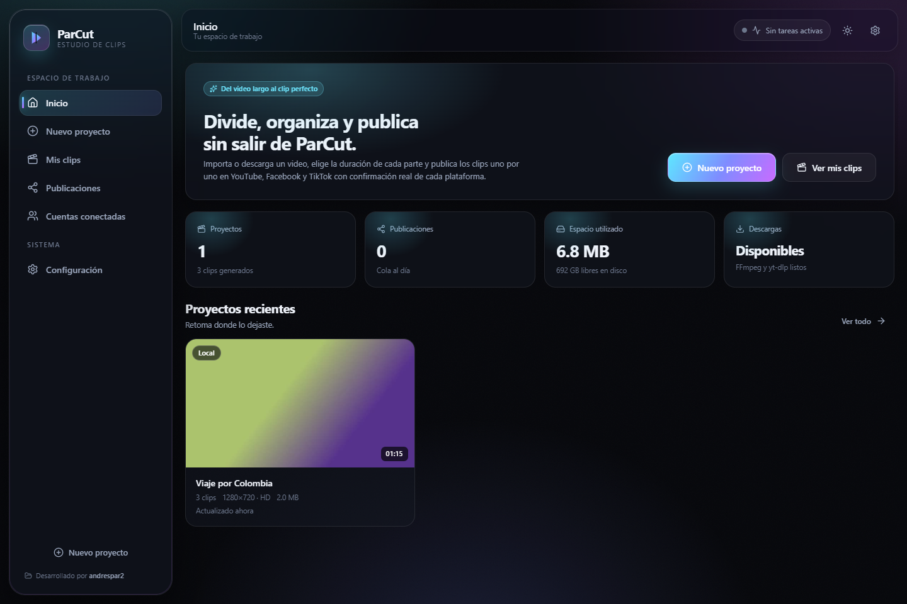

### Capturas

| Proyecto y división | Clips generados |
|---|---|
| 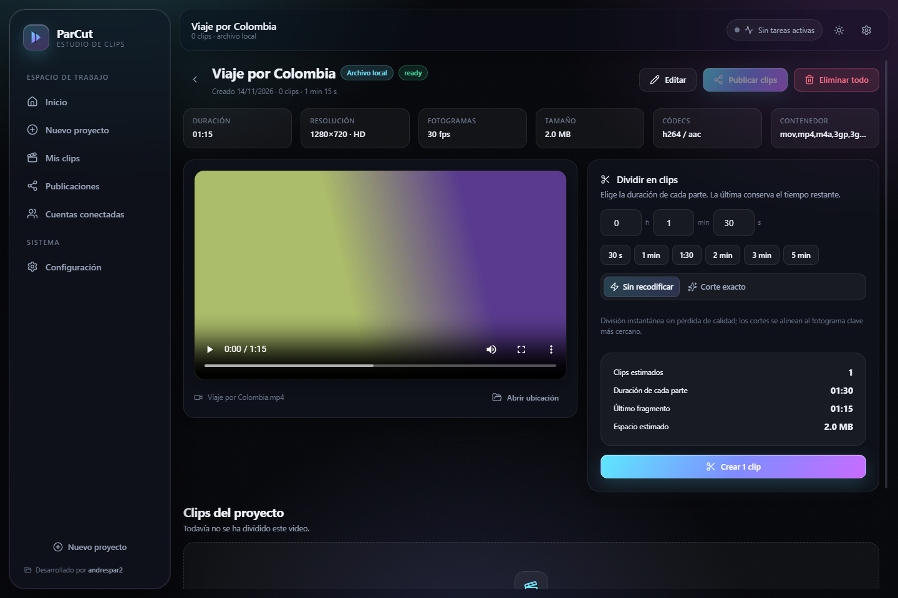 | 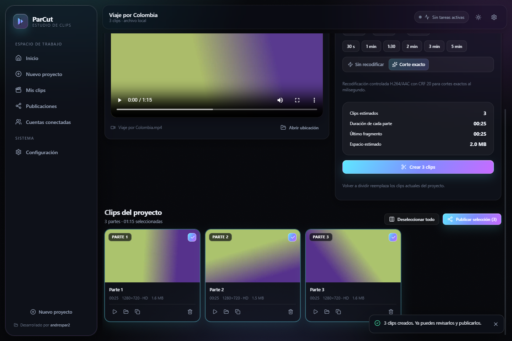 |

| Cola de publicaciones | Cuentas conectadas |
|---|---|
| 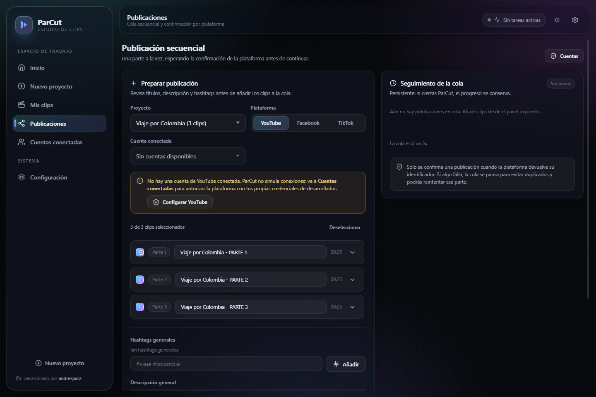 | 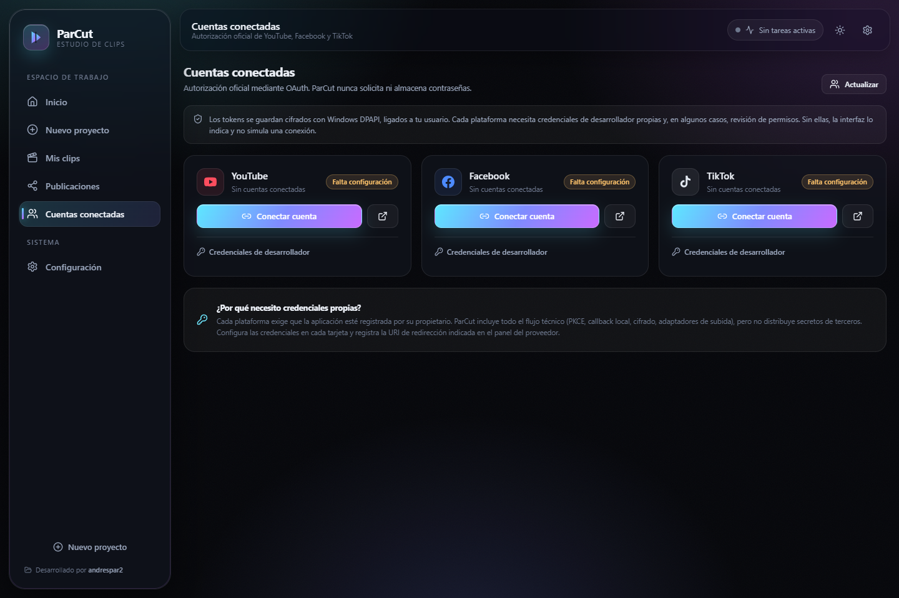 |

| Configuración (oscuro) | Configuración (claro) |
|---|---|
| 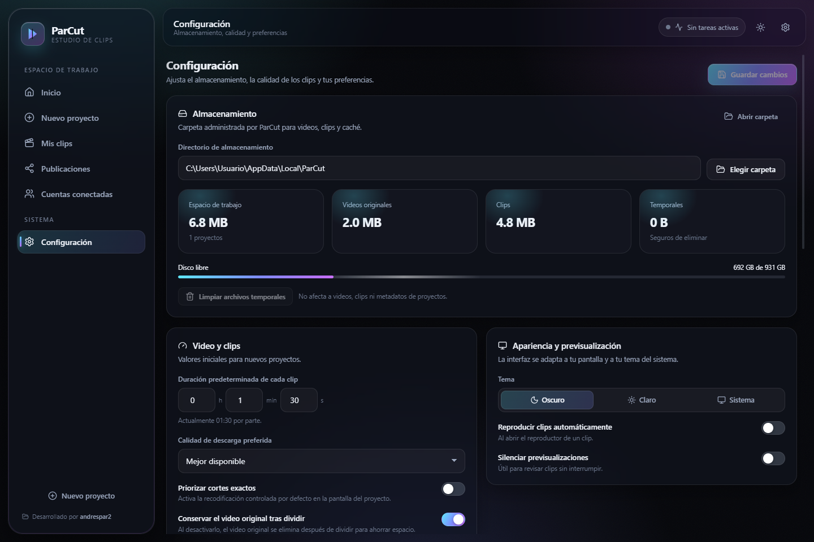 | 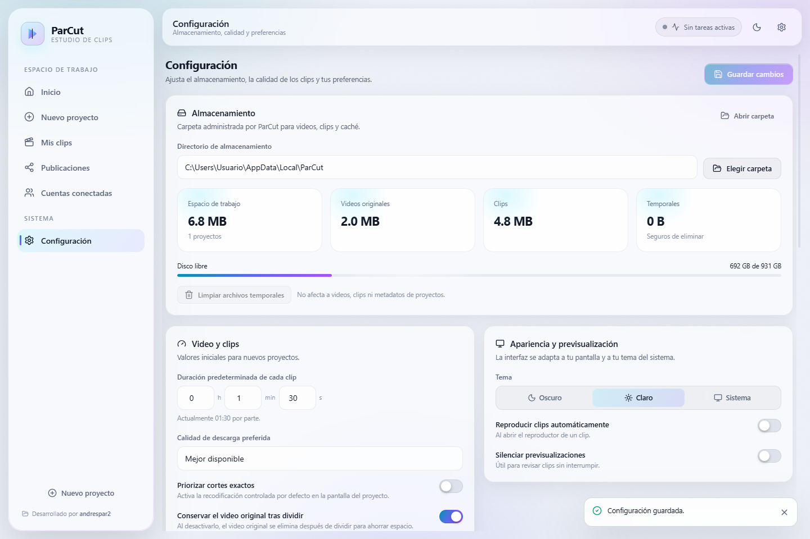 |

**Recorte antes de dividir:** elige desde y hasta qué punto del video se generan los clips, con
barra visual y marcas tomadas directamente del reproductor.

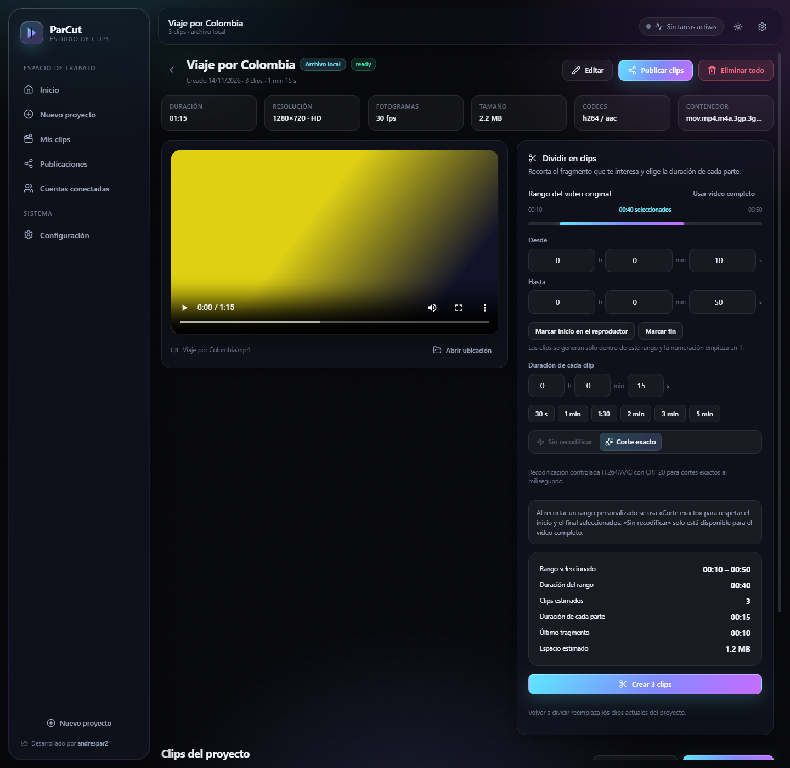

**Navegador integrado:** sesiones independientes para YouTube, Facebook y TikTok, con barra de
direcciones, pestañas y accesos directos a las páginas de subida.

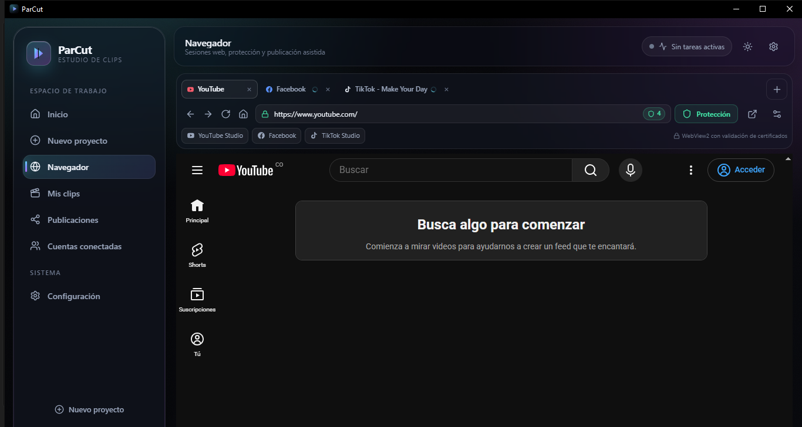

| Protección web de ParCut | Publicación asistida |
|---|---|
| 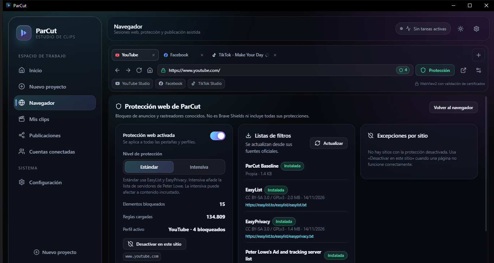 | 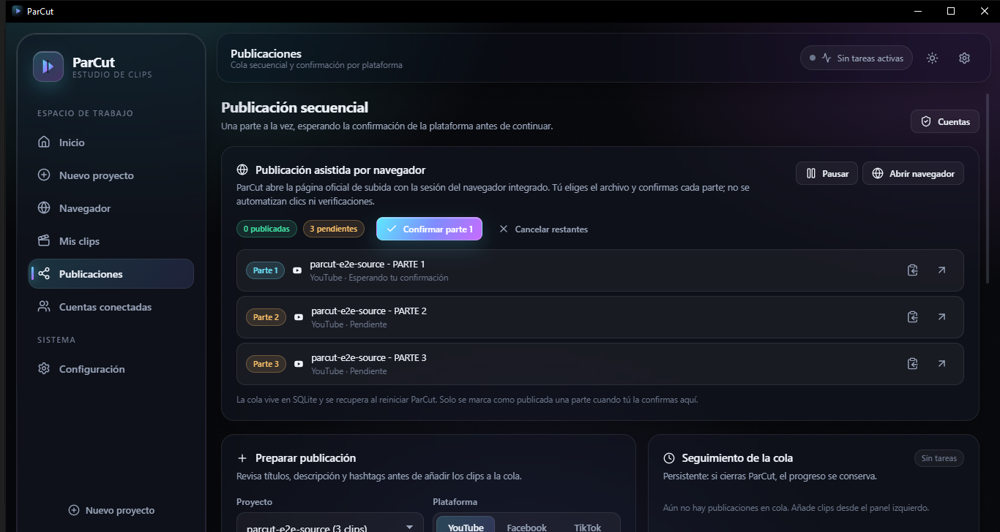 |

**Configuración del navegador:** perfiles, espacio en disco, listas de filtros y limpieza
independiente por plataforma.

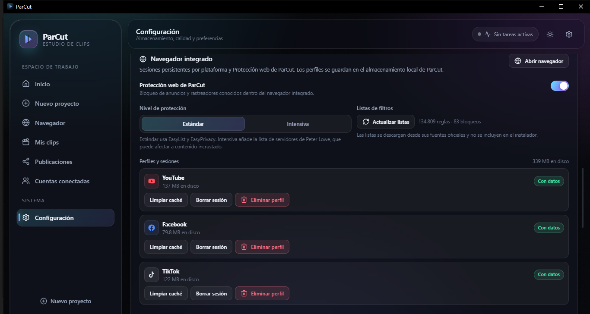

---

## Funcionalidades

### Videos
- Importación local con copia segura al espacio de trabajo.
- Descarga mediante `yt-dlp` de contenido público y autorizado (YouTube, Facebook y otros
  sitios compatibles), con metadatos, selección de calidad, progreso real y cancelación.
- Análisis técnico con FFprobe: duración, resolución, fps, códecs, contenedor y tamaño.
- Reproductor integrado con controles, volumen y pantalla completa.

### División automática
- **Recorte por rango**: elige el punto de inicio y de fin del video original; los clips se
  generan solo dentro de ese fragmento y la numeración de partes empieza en 1.
- Marcas de inicio y fin tomadas directamente del reproductor, barra visual del rango y opción
  para volver al video completo.
- Duración por partes en horas, minutos y segundos, con valores predeterminados.
- Estimación previa: número de clips, duración del último fragmento y espacio aproximado.
- Dos modos de corte:
  - **Sin recodificar**: instantáneo y sin pérdida, alineado a keyframes (video completo).
  - **Corte exacto**: recodificación H.264/AAC controlada (CRF 20) para respetar al milisegundo
    el inicio y el final del rango.
- Miniaturas automáticas, progreso real, cancelación segura y limpieza de archivos parciales.
- Clips ordenados por número de parte y persistidos aunque cierres la aplicación.

### Navegador integrado
- **WebView2 real** dentro de la ventana de ParCut, con pestañas, barra de direcciones, indicador
  de seguridad y botones de atrás, adelante, recargar e inicio.
- Accesos directos a **YouTube Studio**, **Facebook** y **TikTok Studio**.
- **Sesiones persistentes** por plataforma en `%LOCALAPPDATA%\ParCut\browser-profiles`. Cada
  plataforma conserva sus cookies y su `localStorage` al cerrar y reabrir ParCut.
- Opción **Mantener sesión iniciada** (activada por defecto) y limpieza independiente: borrar
  sesión, limpiar caché o eliminar el perfil completo, siempre con confirmación.
- **Protección web de ParCut**: bloqueo de anuncios y rastreadores con `adblock-rust`, listas
  EasyList/EasyPrivacy, nivel intensivo opcional, contador de bloqueos y excepciones por sitio.
- Descargas controladas, bloqueo de ejecutables y botón para abrir la página actual en el
  navegador del sistema.

### Publicación asistida
- Selecciona varios clips en **Mis clips** y elige **Publicar en redes sociales**.
- Edita títulos (`NOMBRE DEL VIDEO - PARTE N`), descripción y hashtags antes de continuar.
- ParCut abre la página oficial de subida con la sesión que ya tienes iniciada y muestra los
  metadatos con un botón para copiarlos.
- La cola es **ordenada y persistente**: una parte a la vez, y solo avanza cuando tú confirmas que
  la publicación se completó. Incluye pausa, reanudación, reintento y cancelación.
- No usa scraping, automatización de clics ni evasión de CAPTCHA; tampoco requiere credenciales
  de desarrollador.

### Publicación por API (opcional)
- Cuentas vinculadas con OAuth 2.0 (PKCE + callback local) de YouTube, Facebook y TikTok.
- Tokens cifrados con **Windows DPAPI**; nunca se guardan contraseñas ni secretos en texto plano.
- Cola **estrictamente secuencial**: una publicación activa, espera la confirmación de la
  plataforma antes de continuar y pausa la cola ante cualquier error.
- Estados por clip: pendiente, preparando, subiendo, publicado, error y cancelado.
- Reintentos sin duplicar: se conserva la sesión de subida (YouTube resumable, Facebook por
  bloques, TikTok FILE_UPLOAD) y se consulta el estado antes de reintentar.
- Progreso general y por publicación, pausa, reanudación y cancelación de las restantes.
- Títulos con formato `NOMBRE DEL VIDEO - PARTE N`, hashtags generales y edición individual.

### Organización y limpieza
- Proyectos con video fuente, clips, miniaturas y metadatos propios.
- Cambio de carpeta de almacenamiento con migración real de los proyectos y sus rutas.
- Opción para eliminar el video original después de dividir y ahorrar espacio.
- **Eliminar todo el proyecto** en un solo paso: video, clips, miniaturas, temporales, caché y
  metadatos, con verificación y bloqueo de rutas ajenas al espacio de ParCut.
- Uso de disco, limpieza de temporales y registro local de actividad.
- Tema Liquid Glass oscuro por defecto y modo claro.

---

## Requisitos

- Windows 10/11 de 64 bits (WebView2 incluido o instalado por el instalador).
- Para usar el instalador: no se requieren dependencias adicionales; FFmpeg, FFprobe y yt-dlp
  se incluyen empaquetados.
- Para desarrollo: Node.js 20+, Rust stable (MSVC), Microsoft C++ Build Tools y WebView2.
- El navegador integrado usa **WebView2 Runtime** (incluido en Windows 11 y en la mayoría de
  instalaciones de Windows 10; el instalador de ParCut lo requiere si falta).

---

## Instalación

### Instalador (usuario final)

1. Descarga `ParCut_1.2.0_x64-setup.exe` desde la sección de releases.
2. Ejecuta el instalador (instalación por usuario, sin privilegios de administrador).
3. Abre ParCut desde el menú Inicio o el acceso directo del escritorio.

El paquete incluye FFmpeg, FFprobe y yt-dlp; no hace falta instalar nada más. La instalación,
la ejecución del binario instalado y la desinstalación se verificaron en Windows de 64 bits.

La desinstalación elimina la aplicación. Los proyectos y la base de datos se guardan en
`%LOCALAPPDATA%\ParCut` y pueden eliminarse por separado si lo deseas.

### Desde el código

```powershell
git clone https://github.com/andrespar2/Parcut.git
cd Parcut
npm install
npm run tools:fetch     # descarga FFmpeg y yt-dlp a src-tauri/binaries
npm run tauri:dev       # desarrollo con recarga en caliente
npm run tauri:build     # instalador NSIS en src-tauri/target/release/bundle/nsis
```

Consulta [`docs/BUILD.md`](docs/BUILD.md) para el detalle del empaquetado y las licencias.

---

## Cómo se usa

1. **Nuevo proyecto**: pega un enlace autorizado o importa un archivo local.
2. **Divide**: de forma opcional, marca el inicio y el final del fragmento que quieres usar
   (puedes tomarlos del reproductor) y elige la duración de cada parte (por ejemplo, 1 min 30 s).
   Pulsa «Crear N clips». El último clip conserva el tiempo restante.
3. **Revisa**: en el proyecto o en **Mis clips** puedes reproducir, abrir la ubicación, copiar el
   nombre o eliminar cada parte.
4. **Inicia sesión en el navegador**: abre **Navegador**, entra en YouTube, Facebook o TikTok y
   accede con tu cuenta. La sesión queda guardada en el perfil de esa plataforma.

   > Google puede rechazar el inicio de sesión dentro de navegadores integrados. Si ocurre, usa el
   > botón **Abrir en el navegador del sistema**; ParCut no intenta evadir esa restricción. Las
   > sesiones dependen de cada plataforma y pueden caducar o revocarse.
5. **Publica de forma asistida**: en **Mis clips**, selecciona los clips y pulsa **Publicar en
   redes sociales**. Elige plataforma, revisa títulos, descripción y hashtags, y añade la cola.
   ParCut abre la página de subida, copia los metadatos con un clic y espera tu confirmación para
   pasar a la siguiente parte.
6. **Publica por API (opcional)**: si prefieres la integración oficial, configura tus credenciales
   de desarrollador y autoriza las cuentas en **Cuentas conectadas**; después usa **Publicaciones**
   y la cola automática.
7. **Limpia**: «Eliminar todo» borra el video, los clips, las miniaturas y los metadatos del
   proyecto, pero **nunca** las sesiones del navegador. También puedes mover la biblioteca a otra
   carpeta desde Ajustes: los proyectos se migran y las rutas se actualizan automáticamente.

### Credenciales de plataformas (solo para la publicación por API)

El navegador integrado y la publicación asistida **no necesitan credenciales de desarrollador**.
Para la integración oficial por API, cada plataforma exige registrar una aplicación propia:

| Plataforma | Requisito principal |
|---|---|
| YouTube | Proyecto en Google Cloud con YouTube Data API v3 y credenciales de escritorio. |
| Facebook | App de Meta con Facebook Login y permisos de Página (`pages_manage_posts`). |
| TikTok | App con Content Posting API; sin auditar, solo permite publicar como «Solo yo». |

Los pasos detallados, las URI de redirección y los permisos están en
[`docs/PUBLISHING.md`](docs/PUBLISHING.md). Si una plataforma no está configurada, ParCut lo
indica y no simula la conexión.

---

## Seguridad y privacidad

- Sin telemetría ni recopilación de datos personales.
- Los tokens OAuth y los secretos de aplicación se cifran con DPAPI (ámbito del usuario de
  Windows) y se guardan en la base local.
- **El navegador no guarda contraseñas ni cookies en la base de datos ni en los registros**: las
  sesiones viven únicamente en los perfiles de WebView2 del equipo.
- Cada plataforma usa un perfil de navegación separado; borrar una sesión no afecta a las demás ni
  a los proyectos de video.
- Se rechazan `javascript:`, `data:`, `file:` y otros esquemas peligrosos; las plataformas se
  abren por HTTPS y la validación de certificados queda en manos de WebView2.
- Las ventanas emergentes se limitan a dominios oficiales y las descargas de ejecutables o scripts
  se bloquean.
- Los procesos externos se ejecutan con argumentos separados y validados; nunca mediante una
  shell concatenada.
- Las URL de descarga se validan (solo http/https, sin redes locales).
- Las rutas de borrado se canonicalizan y deben estar dentro del espacio de trabajo de ParCut.
- Los registros de actividad no incluyen tokens, contraseñas ni códigos OAuth.

---

## Aviso legal

Usa ParCut únicamente con videos propios, con licencia o con autorización del titular. ParCut no
evade DRM, protecciones de acceso, restricciones de autenticación ni controles de pago. Respeta
los términos de uso y los derechos de autor de cada plataforma. Si un sitio no permite la
descarga, importa el archivo desde tu equipo.

FFmpeg se distribuye como programa independiente bajo GPLv3 (build con `libx264`), con su texto
de licencia y enlace al código fuente. yt-dlp se distribuye bajo Unlicense. El motor de bloqueo
`adblock-rust` usa licencia MPL-2.0; EasyList y EasyPrivacy (CC BY-SA 3.0 / GPLv3) se descargan en
el equipo del usuario y no se incluyen en el instalador. El código de ParCut usa licencia MIT.
Consulta [`docs/BUILD.md`](docs/BUILD.md#licencias-de-terceros) y
[`docs/BROWSER.md`](docs/BROWSER.md#8-licencias-y-atribuciones).

---

## Estructura del proyecto

```
src/            Interfaz React + TypeScript (páginas, componentes, store, API tipada)
src-tauri/      Backend Rust (comandos, SQLite, FFmpeg, navegador WebView2, colas de publicación)
docs/           Arquitectura, navegador, publicación por plataforma y compilación
scripts/        Descarga de herramientas y generación de iconos
```

La memoria técnica completa está en [`AGENTS.md`](AGENTS.md) y el historial en
[`CHANGELOG.md`](CHANGELOG.md).

---

## Créditos

**Desarrollado por: andrespar2**

Licencia MIT para el código de ParCut. Terceros: FFmpeg (GPLv3), yt-dlp (Unlicense),
Tauri, React y demás dependencias con sus licencias correspondientes.
